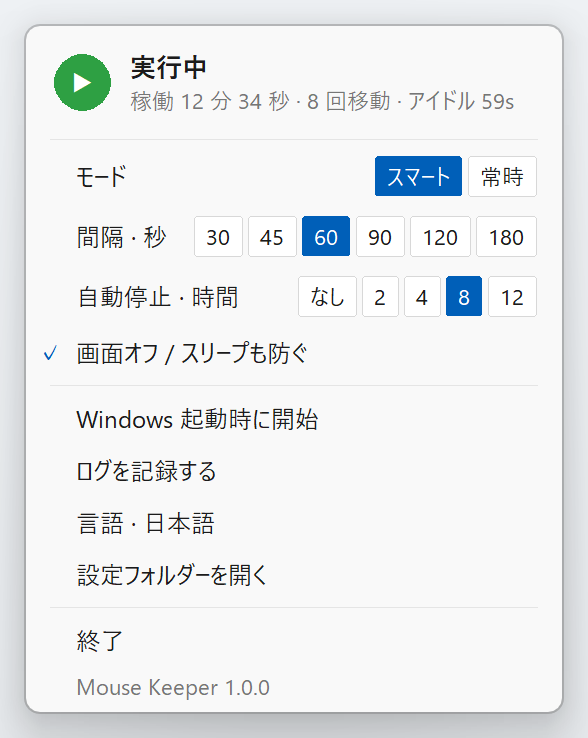

# Mouse Keeper

[English](README.md) · [简体中文](README.zh-CN.md) · **日本語**

タスクトレイに常駐する Windows 向けのキープアライブ ツールです。まだキーボードの
前にいると Windows に思わせることで、システムのアイドル時間から在席状態を判断する
アプリ —— たいていの人にとっては Microsoft Teams —— を「連絡可能」のままに保ちます。



- Win32 API を `ctypes` で直接呼ぶだけ。pyautogui も pynput も使いません
- 2 つのモード：**スマート**（本当に離席したときだけ動かす）/ **常時**（一定間隔で動かす）
- 画面オフとスリープも同時に防ぎます
- **ロック中は自動的に停止**して状態をそのまま表示し、解除後に自動で再開します
- **ストール ウォッチドッグ**：スリープ / モダン スタンバイからの復帰後に自力で回復します
- ワンクリックで Windows 起動時に開始
- **自前描画の Fluent パネル**：角丸、影、ホバー強調、システムのライト / ダーク テーマ追従、高 DPI でも鮮明
- **10 言語対応**、Windows の表示言語から自動判定
- **トレイ アイコンがタスクバーのテーマに追従**、実行中にテーマが変わっても自動で切り替わります

---

## クイック スタート

**ソースから実行**

```bash
python -m venv .venv && .venv\Scripts\pip install -r requirements.txt && .venv\Scripts\pythonw main.py
```

**exe をビルド（推奨）**

```bash
powershell -ExecutionPolicy Bypass -File build.ps1
```

生成物は `dist\MouseKeeper\MouseKeeper.exe` です。ダブルクリックすると通知領域に
アイコンが表示されます。**移動するときは `MouseKeeper` フォルダーごと移動してください。**

既定を `--onefile`（単一 exe）ではなく `--onedir`（フォルダー）にしているのは
意図的です。onefile ビルドは起動のたびに自身を一時ディレクトリへ展開しますが、
その挙動自体がウイルス対策ソフトのヒューリスティックに引っかかります。
PyInstaller の成果物がトロイの木馬と誤検知される主な原因のひとつです。onedir は
展開しないため誤検知がはるかに少なく、起動も速くなります。どうしても単一
ファイルが必要な場合は次のとおりです。

```bash
powershell -ExecutionPolicy Bypass -File build.ps1 -OneFile
```

**まずセルフチェックを実行してください**（この方式がその PC で実際に機能するか
を確認します。強く推奨します）。

```bash
.venv\Scripts\python main.py --check
```

`+ Self-check passed` と表示されれば成功です。失敗する場合は `SendInput` が
システムまたはセキュリティ ソフトにブロックされており、その PC ではこのツールは
動作しません。

セルフチェックの出力は UI の言語にかかわらず**常に英語**です。トラブルシュー
ティングを行う人向けの診断情報だからです。また ASCII 文字のみを使うため、
日本語や中国語のコード ページで出力をパイプしても `UnicodeEncodeError` に
なりません。

---

## 2 つのモード

| | スマート（既定） | 常時 |
|---|---|---|
| 発動条件 | システムがしきい値（既定 60 秒）だけアイドル状態になったとき | N 秒ごとに無条件（既定 45 秒） |
| PC を使っている間 | **完全に無音** —— 一度も動かしません | 動かし続けるため、たまにカーソルを取り合います |
| 使いどころ | 普段づかい。特別な理由がなければこちら | 挙動を完全に予測したい場合、スマート モードが不調な場合 |

スマート モードには整合の取れた性質があります。このツールが注入するイベント自体も
システムのアイドル タイマーをリセットするため、いったん離席すると
`idle_threshold_sec` ごとにきっかり 1 回注入されます。マウスに触れた瞬間からは
アイドル カウンターが自力でリセットされ続けるので、ツールは一度も発動しません。

---

## パネル

トレイ アイコンを右クリックします。

```
┌──────────────────────────────────────┐
│  ●  実行中                            │  ← クリックで切り替え
│     稼働 12 分 · 8 回移動 · アイドル 23s │
├──────────────────────────────────────┤
│  モード             [スマート] 常時    │
│  間隔 · 秒      30 45 [60] 90 120     │
│  自動停止 · 時間    なし 2 4 [8] 12    │
│  ✓ 画面オフ / スリープも防ぐ            │
├──────────────────────────────────────┤
│    Windows 起動時に開始                │
│    ログを記録する                      │
│    言語 · 日本語                       │
│    設定フォルダーを開く                 │
├──────────────────────────────────────┤
│    終了                               │
└──────────────────────────────────────┘
```

| 項目 | 説明 |
|---|---|
| ステータス カード | バッジが実行中 / 一時停止 / ロックを示します。クリックで切り替え。トレイ アイコンの左クリックも同じ動作です |
| モード | スマート / 常時 |
| 間隔 | 30 / 45 / 60 / 90 / 120 / 180 秒 |
| 自動停止 | なし / 2 / 4 / 8 / 12 時間。時間になると自動停止し通知を表示します |
| 画面オフ / スリープも防ぐ | `SetThreadExecutionState` に対応します |
| Windows 起動時に開始 | `HKCU\...\Run` に書き込みます。管理者権限は不要です |
| ログを記録する | `%APPDATA%\MouseKeeper\mouse-keeper.log` に出力します |
| 言語 | 10 言語すべてを並べた 2 ページ目を開きます |
| 設定フォルダーを開く | `%APPDATA%\MouseKeeper\` を開きます |
| 終了 | 設定を保存して終了します |

設定を変更しても**パネルは閉じません**。続けて複数の項目を調整できます。
閉じるのは切り替えと実行系の項目だけです。

トレイ アイコンは 3 状態です。**緑の矢印**（実行中）、**灰色の一時停止**
（一時停止中）、**琥珀色の南京錠**（ロック中）。

**グローバル ホットキー `Ctrl+Alt+F12`** でいつでも一時停止 / 再開できます。
画面を他人に渡すときに便利です。設定ファイルで `"ctrl+shift+f9"` のように
変更できます。

---

## 言語

English、简体中文、繁體中文、日本語、한국어、Deutsch、Français、Español、
Português、Русский。

既定は `auto` で、`GetUserDefaultLocaleName` により Windows の表示言語を読み取り、
一致しない場合は英語にフォールバックします。中国語は `-TW` / `-HK` / `-MO` /
`Hant` のタグで繁体字、それ以外は簡体字に解決されます。

フォントは全体で固定せず言語ごとに切り替えます。YaHei にはハングルが、
Segoe UI には漢字・かなが含まれないため、単一フォントでは一部の言語で
豆腐（□）になってしまいます。

**ログ ファイルは UI の言語にかかわらず常に英語**で書き出されます。ログは
トラブルシューティングのためのものであり、途中で設定を変えたせいで 1 つのログが
2 つの言語に分かれてしまうのは避けたいからです。

---

## 設定

`%APPDATA%\MouseKeeper\config.json`。手動で編集した場合は再起動で反映されます。
パネルから操作できる項目はすべて即座に保存されます。

| キー | 既定値 | 説明 |
|---|---|---|
| `mode` | `"smart"` | `smart` / `force` |
| `idle_threshold_sec` | `60` | スマート モード：動かすまでのアイドル秒数（10〜280） |
| `interval_sec` | `45` | 常時モード：固定間隔（5〜280） |
| `move_pixels` | `1` | 1 回あたりの移動ピクセル数（直後に元へ戻します） |
| `keep_display_on` | `true` | 画面オフも防ぐかどうか |
| `auto_stop_hours` | `8.0` | この時間だけ動かしたら停止、`0` は無制限 |
| `language` | `"auto"` | `auto` または `ja`、`de`、`zh-Hans` などの言語コード |
| `hotkey` | `"ctrl+alt+f12"` | 一時停止 / 再開のグローバル ホットキー |
| `start_active` | `true` | 起動直後からキープアライブを開始する |
| `log_enabled` | `false` | ログ ファイルを書き出す |

上限が 280 秒なのは、Teams がおよそ 5 分（300 秒）入力がないと離席と判定する
ためです。意味を持たせるには、それより十分に短い間隔である必要があります。

---

## 仕組み

```
1 秒ごと（メッセージ タイマーではなく専用スレッド）
  ├─ SetThreadExecutionState(ES_CONTINUOUS|ES_SYSTEM_REQUIRED[|ES_DISPLAY_REQUIRED])
  │     → 画面オフ / スリープを防ぐ
  ├─ OpenInputDesktop() でロック状態を検出 → ロック中はこの周回をスキップ
  ├─ スマート モード：GetLastInputInfo() でアイドル時間がしきい値に達したか判定
  │   常時モード：前回の移動から十分な時間が経過したか判定
  └─ 条件を満たしたら → SendInput(MOUSEEVENTF_MOVE, +1px) → 50ms 待つ → SendInput(-1px)
        → システムの「最終入力時刻」が更新され、カーソルは元の位置に正確に戻る

各周回の終わりに 2 つの時計（monotonic と実時間）を比較します。
その周回に実際 10 秒以上かかっていた場合、マシンは凍結またはスリープしていた
と判断し、電源要求を再宣言してただちに 1 回注入します。
```

重要な点が 3 つあります。

1. **`SetCursorPos` ではなく `SendInput` でなければなりません。** 前者はカーソルを
   移動するだけで入力イベントを生成しないため、`GetLastInputInfo` が参照する
   タイムスタンプは更新されず、Teams は結局「退席中」になります。最もよくある
   間違いです。
2. **PowerToys Awake のようなツールでは解決しません。** これらは
   `SetThreadExecutionState` を呼ぶだけで、スリープは防げても**入力イベントを
   一切生成しない**ため、退席状態の問題には無力です。スリープを防ぐことと退席を
   防ぐことは別の仕事で、本ツールは両方を行います。
3. **移動は相対座標で往復して打ち消される**ため、カーソルは元の位置に正確に戻り、
   作業の邪魔になりません。

### トレイ メニューを自前で描いている理由

Windows のトレイ メニューは通常、OS が描画するネイティブ HMENU
（`CreatePopupMenu` + `TrackPopupMenuEx`）です。OS が受け付けるのはチェック、
無効、ラジオ、区切り線といった意味づけのフラグだけで、**オーナー描画のフックが
ありません**。角丸も余白もホバー強調も実現できないということです。`pystray` は
まさにこの方式なので、本プロジェクトではトレイまわりを丸ごと自前で実装しています。

- `trayicon.py` —— `Shell_NotifyIcon` と隠しメッセージ ウィンドウ。クリックを自分で処理します
- `menu.py` —— `overrideredirect` な tkinter ウィンドウ。パネル全体を 1 枚の Canvas に
  描画し、ウィンドウの角丸と影は DWM（`DWMWA_WINDOW_CORNER_PREFERENCE`）に任せます

**カスケード サブメニューはありません。** モード、間隔、自動停止はすべて行内の
セグメント コントロールです。カスケード メニューはサブメニューへ到達するために
他の行を斜めに横切る必要があり、経路が長くて外れやすい —— Fitts / Steering Law の
典型的な弱点です。セグメント コントロールなら 3 クリックが 1 クリックになります。

**進捗アニメーションもありません。** ステータス カードにあるのは単色の丸い
バッジと白いグリフだけで、トレイ アイコンと同じ視覚言語です。動く進捗リングは
毎秒描き直す必要があり、表示上の不具合が最も出やすい要素である一方、得られる
情報（次の移動まであと何秒か）はその代償に見合いません。

パネルの再描画も同じ考え方です。`Panel.refresh()` はまず「いま画面に出ているべき
内容」のシグネチャを比較し、変化がなければ何もしません。実際に変わるのは詳細行の
テキスト 1 行だけで、1 秒に 1 回で十分です。

スレッド モデル：**UI はすべてメイン スレッドにあります。** tkinter の mainloop が
メイン スレッドで動き、トレイのメッセージは `after` ループ内の `pump()` が取り出し、
キープアライブ エンジンはバックグラウンド スレッドでデータだけを更新します。
UI の更新が必要なときはフラグを立て、メイン スレッドのタイマーが拾います。

はまりどころが 3 つあり、いずれもコード中にコメントを残してあります。

1. `SetProcessDpiAwarenessContext` の引数は**ポインター幅**のハンドルです。Python の
   `-4` をそのまま渡すと ctypes が 32 ビット int としてマーシャリングし、64 ビットでは
   呼び出しが**何も言わずに失敗**します。エラーも戻り値の異常もないのに、プロセスは
   DPI 非対応のままとなり、高 DPI ディスプレイでは UI 全体が引き伸ばされてぼやけます。
2. `pump()` 内の `PeekMessage` は**自分の hwnd でフィルターしなければなりません**。
   `None` を渡すと tkinter の分も含めてスレッド キュー全体を取り去ってしまい、Tk の
   notifier の外で `DispatchMessage` しても対応する Tk イベントは生成されません。
   結果としてマウス入力が消えます。
3. ポインターがウィンドウの外から入ってくるとき、Tk は `<Enter>` を送りますが
   `<Motion>` は送りません。`<Motion>` だけをバインドしていると、マウスが乗っている
   行がマウスを動かすまで強調表示されません。

Windows 10 には `DWMWA_WINDOW_CORNER_PREFERENCE` がないため、ウィンドウは直角に
なります。それ以外への影響はありません。

### タスクバーのテーマごとに 2 組のアイコン

トレイ アイコンは `assets/tray/light/` と `assets/tray/dark/` に完全に独立した
2 組の素材として置かれています（それぞれ `running` / `paused` / `locked` の
3 枚）。これは「ライト版が標準でダーク版は予備」という関係では**ありません**。
どちらも**特定の**タスクバーの色に対してコントラストが取れるよう描かれており、
組み合わせを間違えると「少し見劣りする」どころか判読できなくなります。`light`
セットのカーソルはほぼ黒で、ライトのタスクバー向け。`dark` セットのカーソルは
ほぼ白で、ダークのタスクバー向けです。

Windows はタスクバーのテーマを、パネル自身の配色を決めるアプリ テーマとは別に
公開しています。`SystemUsesLightTheme` と `AppsUseLightTheme` で、どちらも
`HKCU\Software\Microsoft\Windows\CurrentVersion\Themes\Personalize` の下にあります。
設定の「個人用設定 > 色 > カスタム」では「既定の Windows モード」（タスクバー）と
「既定のアプリ モード」（ウィンドウ）を別々に設定できるため、`winui.py` では
この 2 つを別々に読み取り、トレイ アイコンは自分自身のシグナルだけを見て、
パネルの判定に相乗りしません。

### メイン ループがメッセージ タイマーを避けている理由

`arkane-systems/mousejiggler#130` は未解決の厄介な報告です。モダン スタンバイ
（S0 低電力アイドル）のノート PC では、ディスプレイがオフになると
`System.Windows.Forms.Timer` が依存する `WM_TIMER` メッセージが配送されなくなり、
jiggler が**永久に停止**します —— プロセスは生きているのに二度と動きません。

本プロジェクトのメイン ループは `Event.wait()` を使う専用スレッドなので、この問題の
影響を受けません。同じ報告では、そうしたマシンでは `SetThreadExecutionState()` が
システムの電源要求として登録されない可能性にも触れられています。ストール
ウォッチドッグがあるのはそのためで、1 周回が想定よりはるかに長くかかった時点で
電源要求を再宣言し、ただちに注入を行います。

自分のマシンがモダン スタンバイかどうかは `powercfg /a` で確認できます。

---

## 既知の制限

- **ロック中はキープアライブが機能しません。** `Win+L` の後やセキュア デスクトップ
  では入力デスクトップが Winlogon のものになり、`SendInput` は届きません。ツールは
  これを検出して停止し、トレイに「ロック中」と表示して解除後に再開します。ただし
  **ロックしている間は在席状態が落ちます**。これは回避できません。
- **昇格したウィンドウが前面にあると弾かれます。** 前面のウィンドウが管理者権限で
  動いている場合、非昇格プロセスからの `SendInput` は UIPI に拒否されます
  （ログで確認できます）。Windows の設計どおりの動作であり、バグではありません。
- **切断されたリモート デスクトップ セッション**は中断されるため、同じく「ロック中」
  として扱われ一時停止します。
- **ウイルス対策ソフトの誤検知。** PyInstaller の成果物がトロイの木馬と誤認される
  のはよくあることで、本プロジェクトの動作とは関係ありません。既定の onedir
  ビルドで可能な限り確率を下げていますが、企業の EDR は家庭向けソフトとまったく
  異なる判断をします。ブロックされた場合はソースから実行してください
  （`pythonw main.py`）。
- Windows 専用です。全編が Win32 API です。

---

## 使う前に確認してください

Teams の在席状態は、本来その人が実際に対応できるかどうかを示すためのものです。
会社によっては、ツールで在席状態を維持することが IT や人事のポリシー違反に
あたります。また Intune や EDR で管理された PC では、入力の注入は通常監査可能です。
本ツールに企業の監視を回避する機能はありませんし、今後も追加しません。適切かどうかは
ご自身でご判断ください。

---

## プロジェクト構成

```
mouse-keeper/
├── main.py                  エントリ ポイント + --check セルフテスト
├── mouse_keeper/
│   ├── winapi.py            SendInput / GetLastInputInfo / 電源 / ロック検出 / ホットキー
│   ├── winui.py             DPI 対応 / DWM 角丸 / システム テーマ / HICON
│   ├── trayicon.py          Shell_NotifyIcon トレイ アイコン + 隠しメッセージ ウィンドウ
│   ├── menu.py              自前描画の Fluent パネル
│   ├── i18n.py              10 言語の UI 文言 + 言語判定
│   ├── config.py            設定の読み書きと検証
│   ├── engine.py            キープアライブ ループ（バックグラウンド スレッド + ウォッチドッグ）
│   ├── autostart.py         Windows 起動時に開始（HKCU Run エントリ）
│   ├── icon.py              assets/tray から素材を読み込み .ico として書き出す
│   └── tray.py              以上をつなぎ合わせる App
├── assets/tray/             トレイ アイコンの元画像（light/ と dark/ の 2 テーマ分）
├── build.ps1                PyInstaller ビルド スクリプト（単一ファイルは -OneFile）
└── requirements.txt         Pillow のみ。UI は標準ライブラリの tkinter
```

> `build.ps1` は **BOM 付き UTF-8** で保存しています。Windows PowerShell 5.1 は
> BOM のない `.ps1` をシステムの ANSI コード ページで解釈するため、非 ASCII の
> テキストが文字化けし、ひどい場合は引用符の対応が壊れてスクリプトの構文解析
> 自体が失敗します。
>
> コード コメントとドキュメントはどちらも英語です。

---

## ライセンス

[MIT](LICENSE)。
