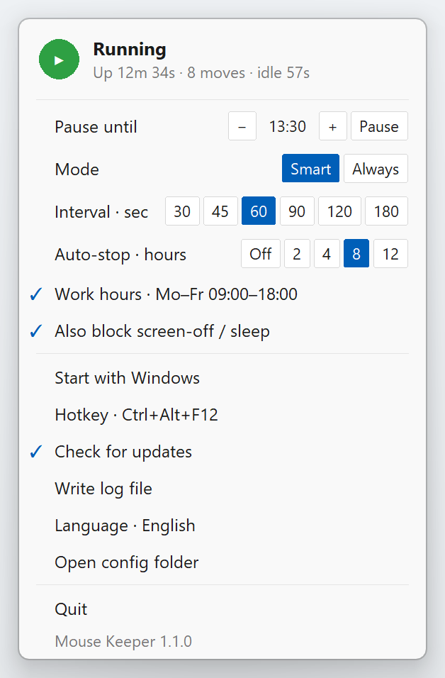

# Mouse Keeper

**English** · [<span lang="zh-CN">简体中文</span>](README.zh-CN.md) · [<span lang="ja">日本語</span>](README.ja.md)

A small Windows tray tool that keeps you showing as available. It makes Windows
believe you are still at the keyboard, so apps that set your status from how
long the PC has been idle — Microsoft Teams being the usual reason people want
this — keep you green instead of switching you to "Away".



- Two modes: **Smart** (only acts once you have actually stepped away) and
  **Always** (acts on a fixed interval).
- The cursor does not visibly move, so it never gets in the way of your work.
- Also keeps the screen on and stops the PC from going to sleep.
- **Work hours**: switch on and off automatically, e.g. Mon–Fri 09:00–18:00.
- **Pause until**: take a break and have it resume by itself at a set time, e.g. 13:30.
- Pauses itself while the PC is locked and resumes when you unlock.
- Recovers on its own after sleep.
- Global hotkey to pause / resume, which you can change from the panel.
- Optional start with Windows, and a notification when a new version is out.
- A modern panel that follows the Windows light / dark theme.
- **10 languages**, picked automatically from your Windows display language.

---

## Download and run

1. Download `MouseKeeper-<version>-win64.zip` from the
   [latest release](https://github.com/Chang8977/mouse-keeper/releases/latest).
2. Unzip it anywhere and run `MouseKeeper\MouseKeeper.exe`.
3. Nothing pops up — look for the icon in the **system tray** at the bottom
   right of the taskbar (it may be tucked away behind the `^` arrow).
   **Left-click** it to start / pause, **right-click** it to open the panel.

No installer and no admin rights are needed. If you move the program later,
move the whole `MouseKeeper` folder, not just the exe.

> **See "Windows protected your PC"?** Click **More info**, then **Run anyway**.

Release builds are produced automatically by GitHub Actions from the published
source code, so the download matches what is in this repository.

---

## Using it

### The two modes

| | Smart (default) | Always |
|---|---|---|
| When it acts | After the PC has been idle for the interval (60 s by default) | Every interval, no matter what (45 s by default) |
| While you are using the PC | Does nothing at all | Keeps acting in the background |
| Best for | Everyday use — pick this unless you have a reason not to | When you want completely predictable behaviour |

### The panel

Right-click the tray icon to open the panel shown in the screenshot above:

| Item | What it does |
|---|---|
| Status card | Shows running / paused / locked, or "Off hours" with the next start time. Click to start or pause |
| Pause until | Set a time with − / + and click **Pause**; it resumes by itself at that time (see below) |
| Mode | Smart / Always (see above) |
| Interval | 30 / 45 / 60 / 90 / 120 / 180 seconds |
| Auto-stop | Stops by itself after 2 / 4 / 8 / 12 hours and lets you know. Off = never |
| Work hours | Opens a page to switch the schedule on, choose the days and set the start / end time |
| Also block screen-off / sleep | Keeps the screen on and stops the PC from sleeping while running |
| Start with Windows | Starts Mouse Keeper when you sign in |
| Hotkey | Click, then press the new key combination. `Esc` cancels, `Backspace` turns the hotkey off |
| Check for updates | Lets you know when a new version is out (see [Privacy](#privacy)) |
| Write log file | Keeps a log for troubleshooting |
| Language | Choose from the 10 languages |
| Open config folder | Opens the folder holding the settings file |
| Quit | Saves the settings and exits |

Changing a setting keeps the panel open, so you can adjust several in a row.

The tray icon shows the current state: **green arrow** (running), **grey pause**
(paused), **amber padlock** (PC locked).

### Pause until

Going to lunch? Set the time on the **Pause until** row (− / + move it by 15
minutes) and click **Pause**. Mouse Keeper pauses right away and resumes by
itself at that time, with a notification. While paused, the button changes to
**Resume now** if you are back early. If the time has already passed today, it
means tomorrow.

Starting or pausing by hand, or with the hotkey, cancels the timer. If your work
hours end during the pause, it stays off for the evening.

### Hotkey

`Ctrl+Alt+F12` pauses / resumes at any time — handy right before you share your
screen. To change it, click the **Hotkey** row in the panel and press the new
combination. It has to include `Ctrl`, `Alt` or `Win`, so it cannot get in the
way of normal typing (function keys also work with `Shift`, and `F13`–`F24` on
their own). If another program already uses that combination, you get a
notification and the old hotkey stays.

### Work hours

Turn on **Run only during work hours** on the Work hours page and Mouse Keeper
starts by itself when your work hours begin and pauses when they end, with a
notification each time.

- It only steps in at those two moments. You can still pause it for lunch or
  switch it on for an evening call, and that stays until the next start or end
  time.
- Started outside work hours, it waits, paused, until the next start time.
- An end time earlier than the start time runs past midnight, e.g.
  22:00–06:00 for a night shift.
- Auto-stop still applies as well.

### Languages

English, <span lang="zh-CN">简体中文</span>, <span lang="zh-TW">繁體中文</span>, <span lang="ja">日本語</span>, <span lang="ko">한국어</span>, Deutsch, Français, Español,
Português, Русский. By default it follows your Windows display language and
falls back to English; you can change it any time from the panel.

---

## Settings file

Everything in the panel is saved automatically to
`%APPDATA%\MouseKeeper\config.json` (**Open config folder** takes you there).
You only need to edit the file for the few options the panel does not show;
restart Mouse Keeper afterwards.

| Key | Default | Meaning |
|---|---|---|
| `mode` | `"smart"` | `smart` / `force` (Always) |
| `idle_threshold_sec` | `60` | Smart mode interval, 10–280 seconds |
| `interval_sec` | `45` | Always mode interval, 5–280 seconds |
| `move_pixels` | `1` | How far each tiny movement goes (it is undone immediately) |
| `keep_display_on` | `true` | Also keep the screen on and the PC awake |
| `auto_stop_hours` | `8.0` | Stop after this many hours, `0` = never |
| `language` | `"auto"` | `auto` or a language code such as `ja`, `de`, `zh-Hans` |
| `hotkey` | `"ctrl+alt+f12"` | Pause / resume hotkey, `""` = none |
| `schedule_enabled` | `false` | Follow the work-hours schedule |
| `schedule_days` | `[0,1,2,3,4]` | Days it covers, Monday = `0` … Sunday = `6` |
| `schedule_start` | `"09:00"` | Work hours begin (`HH:MM`) |
| `schedule_end` | `"18:00"` | Work hours end; earlier than the start = past midnight |
| `check_updates` | `true` | Look for new versions |
| `pause_until` | `"13:30"` | Last time chosen in the Pause until row |
| `start_active` | `true` | Start keeping you active right after launch (ignored while work hours are on) |
| `log_enabled` | `false` | Write a log file |

Intervals stop at 280 seconds because Teams switches you to "Away" after about
five minutes without input.

---

## How it works

Every so often Mouse Keeper sends Windows a one-pixel mouse movement and moves
straight back, so the pointer stays exactly where it was. To Windows that counts
as real input, which resets the idle timer that Teams and similar apps watch.

This is also why tools that only stop the PC from sleeping are not enough: they
keep the screen on, but they do not count as input, so you still go "Away".

---

## Privacy

Checking for updates is the only time Mouse Keeper goes online: one request to
GitHub about 20 seconds after it starts, then once a day, asking which version
is the latest. Nothing else is sent apart from what every web request includes
(your IP address and the program's name and version). It never downloads or
installs anything by itself — it only tells you a new version exists. Untick
**Check for updates** to turn it off completely.

---

## Known limits

- **It cannot keep you active while the PC is locked.** Once you press `Win+L`,
  Windows does not accept input from programs, so your status will go "Away"
  during the lock. Mouse Keeper notices, shows "Locked", and carries on as soon
  as you unlock.
- **Windows running as administrator get in the way.** While such a window is in
  front, Windows blocks the input. This is a Windows security rule, not a bug.
- **Disconnected Remote Desktop sessions** are treated the same as a locked PC.
- **Antivirus warnings.** Some antivirus programs, especially on company PCs,
  wrongly flag small unsigned programs like this one. If yours blocks it, you can
  run it from source instead (below).
- Windows only.

---

## Please check this first

Your Teams status is meant to show whether you are really available. At some
companies, keeping it green with a tool like this goes against IT or HR policy,
and on company-managed PCs this kind of input can usually be seen by IT. Mouse
Keeper has no features for hiding from company monitoring and never will.
Decide for yourself whether it is appropriate where you work.

---

## Running from source

You need **Python 3.10 or newer** (tick "Add python.exe to PATH" when installing
it) and Git. The commands below work in PowerShell, Command Prompt and Windows
Terminal.

```bash
git clone https://github.com/Chang8977/mouse-keeper.git
```

```bash
cd mouse-keeper
```

**Option A — build your own exe (recommended)**

```bash
powershell -ExecutionPolicy Bypass -File build.ps1
```

This sets everything up by itself the first time. The result is
`dist\MouseKeeper\MouseKeeper.exe`.

**Option B — run the source directly**

```bash
python -m venv .venv
```

```bash
.venv\Scripts\pip install -r requirements.txt
```

```bash
.venv\Scripts\pythonw main.py
```

**Self-check.** To make sure the approach works on your PC (useful on a company
machine), run this after either option:

```bash
.venv\Scripts\python main.py --check
```

`+ Self-check passed` means you are good to go. If it fails, the PC or its
security software is blocking the simulated input and Mouse Keeper cannot work
there.

---

## License

[MIT](LICENSE).
