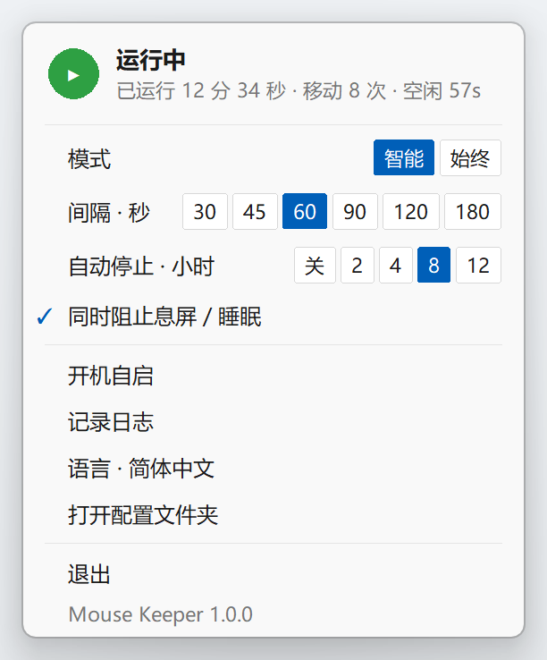

<div lang="zh-CN">

# Mouse Keeper

[English](README.md) · **简体中文** · [<span lang="ja">日本語</span>](README.ja.md)

一个常驻 Windows 托盘的小工具，让你一直显示为"在线"。它让 Windows 以为你还在
电脑前，所以那些根据电脑空闲时间来判断状态的软件 —— 最常见的就是 Microsoft
Teams —— 会一直把你显示为绿色，而不会变成"离开"。



- 两种模式：**智能**（只在你真正离开电脑后才动作）和**始终**（按固定间隔动作）。
- 鼠标指针看不出移动，完全不影响你正常工作。
- 同时可以阻止息屏和电脑睡眠。
- **工作时间**：按设定的时间自动开启和暂停，比如周一至周五 09:00–18:00。
- 锁屏时自动暂停，解锁后自动继续。
- 电脑从睡眠中唤醒后能自己恢复。
- 全局快捷键随时暂停 / 恢复，可以直接在面板里修改。
- 可选开机自启；有新版本时会通知你。
- 现代风格的面板，跟随 Windows 浅色 / 深色主题。
- **支持 10 种语言**，根据 Windows 显示语言自动选择。

---

## 下载与运行

1. 从 [最新 Release](https://github.com/Chang8977/mouse-keeper/releases/latest)
   下载 `MouseKeeper-<版本号>-win64.zip`。
2. 解压到任意位置，运行 `MouseKeeper\MouseKeeper.exe`。
3. 运行后不会弹出窗口 —— 请在任务栏右下角的**系统托盘**里找它的图标（可能被收进了
   `^` 折叠区）。**左键单击**图标开始 / 暂停，**右键单击**打开面板。

不需要安装，也不需要管理员权限。以后要挪位置的话，请把整个 `MouseKeeper`
文件夹一起挪，不要只挪 exe。

> **提示"Windows 已保护你的电脑"？** 点击 **更多信息**，再点 **仍要运行** 即可。

Release 中的安装包由 GitHub Actions 根据公开的源码自动构建，下载到的就是这个仓库里的代码。

---

## 使用说明

### 两种模式

| | 智能（默认） | 始终 |
|---|---|---|
| 何时动作 | 电脑空闲达到设定间隔后（默认 60 秒） | 每隔设定间隔就动作一次（默认 45 秒） |
| 你在用电脑时 | 完全不动作 | 在后台照常动作 |
| 适合 | 日常使用 —— 没有特别理由就选它 | 想要行为完全可预期时 |

### 面板

右键单击托盘图标即可打开面板（见上方截图），各项作用如下：

| 项 | 作用 |
|---|---|
| 状态卡 | 显示运行 / 暂停 / 锁屏，或"非工作时间"及下次开始时间。点一下开始或暂停 |
| 模式 | 智能 / 始终（见上文） |
| 间隔 | 30 / 45 / 60 / 90 / 120 / 180 秒 |
| 自动停止 | 运行 2 / 4 / 8 / 12 小时后自动停止并通知你；"关"表示不限 |
| 工作时间 | 打开设置页：开关时间表、选择星期、设置开始 / 结束时间 |
| 同时阻止息屏 / 睡眠 | 运行期间保持屏幕常亮，电脑不进入睡眠 |
| 开机自启 | 登录 Windows 时自动启动 Mouse Keeper |
| 快捷键 | 点一下，然后按下新的组合键；`Esc` 取消，`Backspace` 关闭快捷键 |
| 自动检查更新 | 有新版本时通知你（见[隐私说明](#隐私说明)） |
| 记录日志 | 保存一份日志，方便排查问题 |
| 语言 | 在 10 种语言中选择 |
| 打开配置文件夹 | 打开存放设置文件的文件夹 |
| 退出 | 保存设置并退出 |

修改设置时面板不会关闭，可以连续调整多项。

托盘图标会显示当前状态：**绿色箭头**（运行中）、**灰色暂停**（已暂停）、
**琥珀色挂锁**（电脑已锁屏）。

### 快捷键

`Ctrl+Alt+F12` 随时暂停 / 恢复 —— 准备共享屏幕之前按一下很方便。要修改的话，
点击面板里的**快捷键**一行，再按下新的组合键即可。组合键必须包含 `Ctrl`、`Alt`
或 `Win` 之一，这样才不会影响正常打字（功能键配 `Shift` 也可以，`F13`–`F24`
可以单独使用）。如果这个组合已被其他程序占用，会弹通知提示，原来的快捷键保持不变。

### 工作时间

在"工作时间"设置页里打开**仅在工作时间运行**后，Mouse Keeper 会在上班时间开始时
自动开启、下班时间到了自动暂停，每次都会弹通知。

- 它只在这两个时间点动作。中途你仍然可以手动暂停去吃午饭，或者晚上开会时手动打开，
  你的选择会一直保持到下一个开始或结束时间。
- 在工作时间之外启动时，它会保持暂停，等到下一个开始时间。
- 结束时间早于开始时间表示跨过午夜，比如夜班 22:00–06:00。
- "自动停止"仍然同时生效。

### 语言

English、简体中文、<span lang="zh-TW">繁體中文</span>、<span lang="ja">日本語</span>、<span lang="ko">한국어</span>、Deutsch、Français、Español、
Português、Русский。默认跟随 Windows 显示语言，匹配不上时使用英语；
随时可以在面板里切换。

---

## 设置文件

面板里的所有设置都会自动保存到 `%APPDATA%\MouseKeeper\config.json`
（点**打开配置文件夹**即可找到）。只有少数面板里没有的选项才需要手动改文件，
改完后重启 Mouse Keeper 生效。

| 键 | 默认值 | 含义 |
|---|---|---|
| `mode` | `"smart"` | `smart`（智能）/ `force`（始终） |
| `idle_threshold_sec` | `60` | 智能模式的间隔，10–280 秒 |
| `interval_sec` | `45` | 始终模式的间隔，5–280 秒 |
| `move_pixels` | `1` | 每次微小移动的距离（移动后立即移回） |
| `keep_display_on` | `true` | 是否同时保持屏幕常亮、电脑不睡眠 |
| `auto_stop_hours` | `8.0` | 运行这么多小时后自动停止，`0` = 不限 |
| `language` | `"auto"` | `auto` 或语言代码，如 `ja`、`de`、`zh-Hans` |
| `hotkey` | `"ctrl+alt+f12"` | 暂停 / 恢复快捷键，`""` = 不使用 |
| `schedule_enabled` | `false` | 是否按工作时间运行 |
| `schedule_days` | `[0,1,2,3,4]` | 生效的星期，周一 = `0` … 周日 = `6` |
| `schedule_start` | `"09:00"` | 上班时间（`HH:MM`） |
| `schedule_end` | `"18:00"` | 下班时间；早于上班时间表示跨过午夜 |
| `check_updates` | `true` | 是否检查新版本 |
| `start_active` | `true` | 启动后立即开始保持在线（开启工作时间后此项不生效） |
| `log_enabled` | `false` | 是否写日志文件 |

间隔最大为 280 秒，是因为 Teams 大约 5 分钟没有输入就会把你显示为"离开"。

---

## 工作原理

Mouse Keeper 每隔一段时间向 Windows 发送一次 1 像素的鼠标移动，然后立即移回，
所以指针始终停在原处。对 Windows 来说这算是真实的输入，于是 Teams 等软件
所依据的空闲计时就会被重置。

这也是为什么只阻止电脑睡眠的工具不够用：它们能让屏幕保持常亮，但不算作输入，
你照样会变成"离开"。

---

## 隐私说明

检查更新是 Mouse Keeper 唯一会联网的时候：启动约 20 秒后向 GitHub 请求一次，
之后每天一次，只是询问最新的版本号。除了每个网络请求都会带的信息（你的 IP 地址，
以及程序名称和版本号）之外，不发送任何内容。它也不会自行下载或安装任何东西，
只会告诉你有新版本。取消勾选**自动检查更新**即可完全关闭。

---

## 已知限制

- **锁屏期间无法保持在线。** 按下 `Win+L` 之后，Windows 不再接受程序发出的输入，
  所以锁屏期间你的状态会变成"离开"。Mouse Keeper 会察觉到这一点，显示"已锁屏"，
  解锁后立即继续。
- **以管理员身份运行的窗口会造成干扰。** 这类窗口在最前面时，Windows 会拦截输入。
  这是 Windows 的安全规则，不是 bug。
- **断开连接的远程桌面会话**与锁屏同样处理。
- **杀毒软件误报。** 一些杀毒软件（尤其是公司电脑上的）会把这类没有签名的小程序
  误判为可疑。如果被拦截，可以改为从源码运行（见下文）。
- 只支持 Windows。

---

## 用之前请想清楚

Teams 的状态本意是反映你是否真的有空。在一些公司，用这类工具保持绿色违反 IT 或
人事规定；在公司统一管理的电脑上，这类输入通常也能被 IT 看到。Mouse Keeper
没有任何规避公司监控的功能，以后也不会有。请自行判断在你的工作环境里是否合适。

---

## 从源码运行

需要 **Python 3.10 或更新版本**（安装时勾选 "Add python.exe to PATH"）以及 Git。
下面的命令在 PowerShell、命令提示符和 Windows 终端里都能用。

```bash
git clone https://github.com/Chang8977/mouse-keeper.git
```

```bash
cd mouse-keeper
```

**方式一：自己打包成 exe（推荐）**

```bash
powershell -ExecutionPolicy Bypass -File build.ps1
```

第一次运行会自动准备好所需的一切，产物在 `dist\MouseKeeper\MouseKeeper.exe`。

**方式二：直接运行源码**

```bash
python -m venv .venv
```

```bash
.venv\Scripts\pip install -r requirements.txt
```

```bash
.venv\Scripts\pythonw main.py
```

**自检。** 想确认这台电脑上能不能用（在公司电脑上尤其有用），完成上面任一方式后运行：

```bash
.venv\Scripts\python main.py --check
```

看到 `+ Self-check passed` 就说明没问题。如果不通过，说明这台电脑或其安全软件
拦截了模拟输入，Mouse Keeper 在这台电脑上无法工作。

---

## 许可证

[MIT](LICENSE)。

</div>
